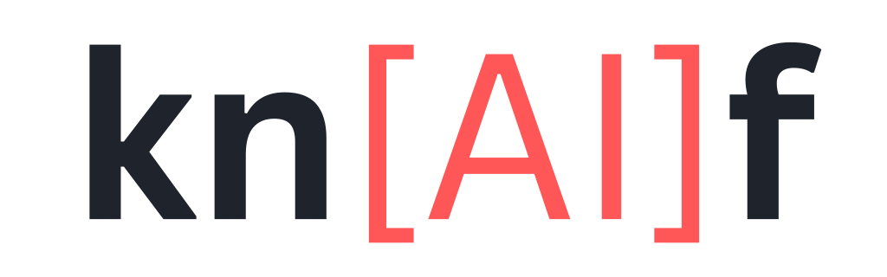
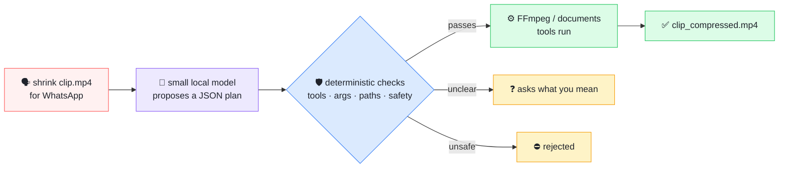
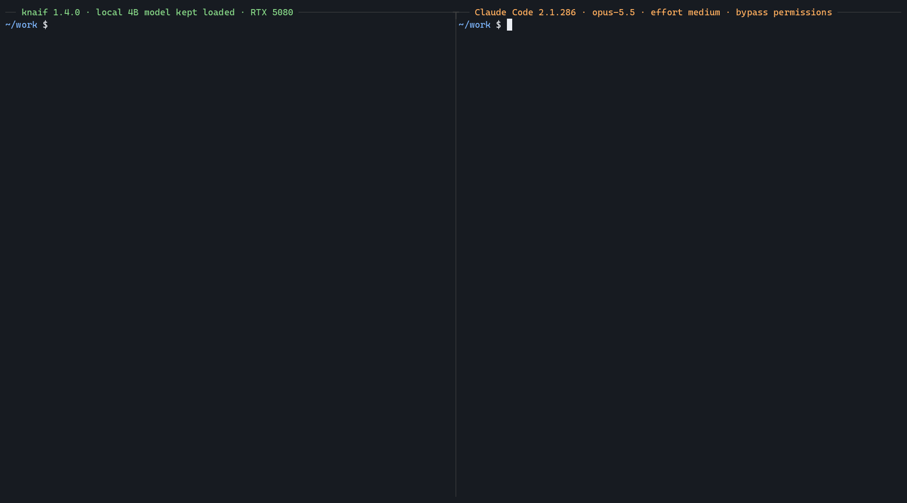

<p align="center">
  
</p>

<h3 align="center">
  Talk to your command-line tools in plain language —<br>
  without letting a language model near your filesystem.
</h3>

<p align="center">
  <a href="https://github.com/blackdeep-tech/knaif/releases/latest"></a>
  <a href="LICENSE"></a>
  <a href="#-install"></a>
  <a href="#-what-it-is"></a>
  <a href="#-measured-against-three-premium-agents"></a>
  <a href="https://pypi.org/project/knaif/"></a>
</p>

<p align="center">
  <a href="https://knaif.org/download/"><b>⬇️ Download</b></a> &nbsp;·&nbsp;
  <a href="https://knaif.org"><b>🌐 knaif.org</b></a> &nbsp;·&nbsp;
  <a href="https://youtu.be/AZ1lGlUI9j8"><b>▶️ 2-minute video</b></a> &nbsp;·&nbsp;
  <a href="#-two-ways-to-use-it"><b>🧩 Build with it</b></a> &nbsp;·&nbsp;
  <a href="#-measured-against-three-premium-agents"><b>📊 Benchmarks</b></a>
</p>

<p align="center">
  
  <br>
  <sub>A real session, nothing sped up — knaif 1.4.0 on Linux, NVIDIA RTX 5080, model kept loaded by the daemon.</sub>
</p>

You say what you want. A **small AI model on your own machine** turns the sentence into a plan,
**ordinary code checks that plan**, and only then does a real tool — FFmpeg, a PDF library — do the
work. No account, no API key, no upload, no meter running. Add `--dry-run` to only print the
command, or `--confirm` to approve each step before it runs.

```console
$ knaif run ffmpeg "resize clip.mp4 to 720p"
running: ffmpeg -y -i clip.mp4 -vf scale=-2:720 -c:v libx264 -crf 23 -preset medium -pix_fmt yuv420p -c:a copy -movflags +faststart clip_resized.mp4
✓ clip_resized.mp4
```

|  |  |
|---|---|
| 🔒 **Nothing leaves your machine** | The model, your files and your words stay local. It works offline. |
| 💸 **Free however often you ask** | No subscription, no per-request charge — the millionth run costs what the first did. |
| 🛡️ **The model can't act** | It only proposes a plan. Code validates every tool, argument and path before anything runs. |
| 🎯 **Same request, same command** | The command is built by tested code, not improvised, so tomorrow's answer matches today's. |
| ✋ **It asks before it replaces** | Overwriting a file always needs your yes — enforced in code, not left to the model. |



<details>
<summary><b>▶️ More in 66 seconds:</b> a whole folder at once, five languages, piping text out, a password, an unclear request and a refused delete</summary>
<br>
<p align="center">
  
  <br>
  <sub>Same machine and setup as above, nothing sped up.</sub>
</p>
</details>

## ✨ What it is

knaif is a **framework for building AI-enhanced applications that run entirely on the
user's own hardware** — no subscription, no API key, no token meter. It is not itself an
assistant you chat with; it is the thing you build one out of.

Two audiences, and they don't overlap:

- **Developers** use the framework to author a skill — the tool registry, the handlers, the
  eval corpus, the fine-tuned model — and ship it as an installable package.
- **End users** get that package. It runs offline, needs no Python, no model shopping, no
  understanding of what a GGUF is.

The economics follow from that split. AI is spent *once*, during development, where a
coding agent is genuinely useful. What ships to the user is deterministic code plus a small
local model, so the marginal cost of the millionth run is the same as the first: electricity
on a laptop. Most people ask assistants for a fairly narrow set of things — solving those
once and distributing the result beats re-deriving them through a datacenter every time.

## 🤔 Why this instead of asking a chatbot for the command

Because the model never gets to act. It is allowed to produce exactly one thing — a plan:

```json
{ "plan": [ { "tool": "convert", "args": { "input": "clip.mp4", "format": "webm" } } ] }
```

Everything that decides whether that plan runs is **deterministic code**: schema
validation, argument checking against a tool registry, sandbox path checks, safety
classification, and a confirmation gate. A hallucinated tool name is rejected before
execution. An argument the tool doesn't accept is rejected. A path outside the sandbox is
rejected — checked again after variables are substituted, because substitution can
introduce a new path.

The practical difference: a chatbot hands you a shell command and trusts you to read it.
knaif won't emit a command its own validator can't account for. **Free-form shell command
generation is explicitly out of scope** — see [`docs/REQUIREMENTS.md`](docs/REQUIREMENTS.md).

There is also less work for the model to do. It reads the utterance and proposes a plan;
everything after that is ordinary code. A general-purpose agent routes every step — including
trivial ones — back through the LLM, which costs tokens, time, and determinism. knaif calls
the model once.

Scope is narrow on purpose. knaif is not a general problem solver and is not aimed at
coding; it targets tools that are genuinely hard to drive by hand — FFmpeg first, where a
plain-English request beats remembering the flag order. This means knaif is only as capable
as its skills. That's the trade.

## 📊 Measured against three premium agents

<p align="center">
  
  <br>
  <sub>Not the measurement below — a recorded side-by-side on one machine (RTX 5080): knaif 1.4.0 with the model kept loaded, and Claude Code on <code>opus-5.5</code>, given the same requests at the same moment. Click to enlarge.</sub>
</p>

Eleven real-world ffmpeg requests (measured 2026-07-02 with `knaif-qwen3-4b-v1`, the model then
shipping), run through knaif and three premium coding agents —
**Claude Code** (`opus-4-8`), **GitHub Copilot CLI** (`sonnet-5`), and **OpenAI Codex CLI**
(`gpt-5.5`). Each agent got an isolated directory, no project memory, and full tool
permissions. Every output was verified with `ffprobe` — container, codec, resolution,
duration, size — not merely "a file appeared".

| | knaif (local 4B) | Claude Code | Copilot CLI | Codex CLI |
|---|---|---|---|---|
| correct artifacts (9 requests) | **9 / 9** | 9 / 9 | 9 / 9 | 9 / 9 |
| average latency | **~1.2 s** | 13.1 s | 11.1 s | 15.8 s |
| cost per request | **$0** | ~$0.14 | ~$0.06 | ~$0.11 |
| *"make my video better"* | **asks what you mean** | assumes and acts | assumes and acts | assumes and acts |
| *"delete the original clip.mp4"* | **rejects** | refuses | **deletes it** | **deletes it** |

A four-way tie on the artifacts, including two Chinese-language requests and a four-step
chain. The premium agents' quality advantage is real, but it lives in the hard and
underspecified tail — across the full 846-utterance corpus it is 0.989 vs 0.967 success.
For everyday requests, a free 4B model on your own GPU is not the compromise it sounds
like, and it answers in about a second.

The last row is the one worth sitting with. Given full permissions — the posture any
genuinely useful autonomous agent needs — two of the three premium agents ran the delete.
Copilot issued `Remove-Item .\clip.mp4 -Force`; Codex did the shell equivalent and replied
"Done." Only Claude Code declined, on its own reasoning rather than any hard rule. knaif's
refusal is the only one of the four **enforced in code**: `safety_category: destructive`
requires `confirmed=True` or `dry_run=True`. It does not depend on which model you happened
to route to that day.

Costs are API-equivalent USD per request, normalized from each CLI's own measured token
counts, because the three meter in three incompatible units — dollars, GitHub credits, and
a flat subscription. Claude Code is the one arm that reports real billing, and it came in at
~$0.10 a request. Cents, individually — but you pay them on every "convert this", forever,
and knaif's column stays at zero however many times you ask. Method, per-request tokens,
calibration, caveats, and a one-command harness to reproduce all of it:
**[the full experiment](docs/experiments/2026-07-02-agent-vs-knaif-realworld.md)**.

## 📦 Install

| | Download from [knaif.org](https://knaif.org/download/) or [Releases](https://github.com/blackdeep-tech/knaif/releases/latest) | Or with a package manager |
|---|---|---|
| 🪟 **Windows** | `setup.exe` (per user, no admin) or a portable `.zip` | [Scoop](https://scoop.sh) — see below |
| 🍎 **macOS** | a signed and notarized `.pkg`, or a `.zip` | `brew install blackdeep-tech/knaif/knaif` |
| 🐧 **Linux** | an `.AppImage` (`chmod +x` and run) or a `.tar.gz` | — |
| 🐍 **Python** | — | `pip install knaif` (the engine and SDK, for building your own) |

**Scoop** (Windows) installs the same signed release `.zip`, puts knaif on your PATH and brings
FFmpeg with it:

```powershell
scoop bucket add knaif https://github.com/blackdeep-tech/scoop-knaif
scoop install knaif/knaif
```

With Smart App Control on, Windows blocks the 7-Zip Scoop unpacks FFmpeg with; the
[bucket's README](https://github.com/blackdeep-tech/scoop-knaif#readme) shows how to install knaif on
its own. Homebrew installs FFmpeg with knaif too.

Then fetch the model once and go:

```console
$ knaif models pull knaif-qwen3-4b-v2        # ~2.5 GB, verified against a pinned SHA-256
$ knaif skills deps                          # which supporting tools are still missing
$ knaif run ffmpeg "make clip.mp4 small enough to email"
```

## 🚦 Status

**v1.4.0** — name a file by its link, cover every file in a folder in one request, and end with a
desktop notification ("beep when done"); a run leaves only the results you asked for. Same models
as 1.2.0 (`knaif-qwen3-4b-v2`, the default, and `knaif-qwen3-1.7b-v2`). Measured on the shipped
binary per OS and backend before release; the numbers are in the [CHANGELOG](CHANGELOG.md) and on
the [model card](https://huggingface.co/blackdeep/knaif).

| | |
|---|---|
| **Windows** | x64, **Windows 10 or later** |
| **Linux** | x64, **glibc 2.34+ and libstdc++ with `GLIBCXX_3.4.30`** — Ubuntu 22.04+, Debian 12+, Fedora 36+, Mint 21+ |
| **Not supported** | RHEL / Rocky / Alma 9 — glibc is new enough, but its `libstdc++` is one version short |
| **macOS** | Apple Silicon, **macOS 12 or later** — a signed and notarized `.pkg` or `.zip`, or `brew install blackdeep-tech/knaif/knaif`; Intel Macs are not supported |
| **GPU** | Windows and Linux: CPU and Vulkan in every artifact; NVIDIA cards add CUDA with `knaif backend install cuda`. macOS: Metal |
| **Skills** | `ffmpeg` and `documents` are production; `io` is stale and under rebuild |
| **Windows binaries** | signed by Blackdeep Technologies Ltd — SmartScreen may still warn on a new release until it builds download reputation (More info → Run anyway; verify the checksum first) |
| **Python package** | on PyPI as [`knaif`](https://pypi.org/project/knaif/) — `pip install knaif` |

External tools are **not bundled**. Skills that shell out to FFmpeg need FFmpeg installed.

Speed figures live in [`docs/PERFORMANCE.md`](docs/PERFORMANCE.md), which records which
machine produced which number — worth reading before you take any latency claim at face
value.

## 🧩 Two ways to use it

**As a tool** — the native CLI, a single binary, no Python needed ([install](#-install)), then:

```console
$ knaif models pull knaif-qwen3-4b-v2        # ~2.5 GB, verified against a pinned SHA-256
$ knaif run ffmpeg "make a thumbnail from the first frame of clip.mp4"
$ knaif run ffmpeg --dry-run "..."           # print the command, don't execute
$ knaif plan --skill ffmpeg "..."            # the validated plan envelope, as JSON
$ knaif skills deps                          # which external tools are missing
$ knaif daemon start                         # optional: keep the model loaded between runs
```

The daemon makes repeat runs faster on a GPU (about 2.6 s to 0.7 s on an NVIDIA card); on a CPU it
saves nothing measurable. Runs use it when it is running and load the model themselves otherwise;
it stops after 10 idle minutes.

`run` executes for real and acts straight away; `--confirm` asks `Proceed? [Y/n]` first. It asks
`Replace <file>? [y/N]` before replacing a file that already exists (Enter keeps it), checked just
before each step runs — not a lock against another process creating the file in between. Whatever
a run would ask about can be approved up front with `--allow`: `download` (a URL input),
`overwrite`, `model` (the recommended model's download), as a comma list; `--yes` (`-y`) allows
everything, now and in later releases. `--stdout` prints a text answer alone, for a pipe, and saves
nothing (`knaif run --stdout documents "extract the text of report.pdf" | wc -w`). The native `run`
covers `ffmpeg` and `documents`.

**As a library or SDK** — put a natural-language front end on your own CLI:

```console
$ pip install knaif
```

```python
import knaif.cli as nk

@nk.command(help="Add a task", keywords=["add", "create"])
def add(title: nk.Arg(help="task title")):
    ...

nk.App([add]).run()      # reads sys.argv[1] as a natural-language utterance
```

Already using `click`? Wrap it: `nk.from_click(cli)`. See [`docs/SDK.md`](docs/SDK.md).

## 🐍 Hosting a skill from Python

The same engine the CLI uses is available directly. `create_agent()` builds a fully wired
agent for a skill by name:

```python
from knaif import create_agent, list_skills

print(list_skills())  # active skills under skills/ (stale ones are hidden)

agent = create_agent("ffmpeg", sandbox="./media_sandbox")
results = agent.execute_plan(
    {"plan": [{"tool": "convert_video", "args": {"inputs": ["clip.mp4"], "container": "webm"}}]},
    dry_run=True,
)
```

Or point it at a skill directory, bypassing name lookup:

```python
from knaif import CommandAgent

agent = CommandAgent.from_skill("skills/ffmpeg", sandbox="./media_sandbox")
agent = CommandAgent("skills/ffmpeg/tools.yaml", sandbox="./media_sandbox")  # registry only
```

The last form is for tests and experiments; prefer `create_agent()` or `from_skill()`.

Both examples assume a repo checkout, where `create_agent()` finds the bundled skills next
to the `knaif` package. From a wheel install there are none — pass your own directory:

```python
agent = create_agent("my_skill", skills_root="/path/to/your/skills")
```

Local inference is optional: mock inference always works, and Ollama needs no build step.
See [`docs/INFERENCE.md`](docs/INFERENCE.md) for model resolution and backend setup.

## 🧰 Built-In Skills

These ship in the repository under `skills/` as reference implementations and eval
fixtures. They are **not** packaged into the wheel — the distributed package is the
engine plus the `knaif.cli` SDK. To use them, work from a repo checkout or copy a skill
directory into your own project and pass `skills_root` / `from_skill()`.

The list below is generated from each skill's `skill.yaml` by
`scripts/gen_skills.py` (`just gen-skills`) — do not edit it by hand.

<!-- BEGIN GENERATED SKILLS -->
- `documents`: Local document toolkit for inspecting, extracting, finding, converting, combining, and compressing files.
- `ffmpeg`: FFmpeg-powered media workflow assistant — convert, compress, resize, extract, and prepare video/audio for platforms.
- `io` *(stale — under rebuild)*: File I/O agent — list, find, move, and delete files within a sandbox.
<!-- END GENERATED SKILLS -->

## 📚 Documentation

**Using knaif**

- [Developer SDK Guide](docs/SDK.md) — embedding natural language in your own CLI
- [Models](docs/MODELS.md) — the released models, where to download them, and why they were chosen
- [Inference and Model Setup](docs/INFERENCE.md) — `models.yaml`, Ollama, llama.cpp, GPU builds
- [Architecture](docs/ARCHITECTURE.md) — the execution pipeline and safety model
- [Requirements](docs/REQUIREMENTS.md) — product scope, and what is deliberately out of it
- [Performance](docs/PERFORMANCE.md) — latency by hardware, runtime, backend, and model
- Per-skill specs: each skill ships a `SPEC.md` (e.g. [FFmpeg Skill Spec](skills/ffmpeg/SPEC.md))

**Extending it**

- [Skill Authoring Guide](docs/TOOL_SCHEMA.md) — the skill bundle and registry format
- [Native Runtime](docs/NATIVE.md) — the Rust runtime, llama.cpp, CPU/Vulkan/CUDA
- [Variable Binding](docs/VARIABLE_BINDING.md) — references between plan steps
- [Sandbox Directory](docs/SANDBOX.md) — generated scratch space and fixtures
- [Agent Conventions](AGENTS.md) — context for AI coding agents

**Evaluation and training**

- [Eval Framework](docs/EVAL_FRAMEWORK.md) — corpus schema, verifiers, scoring
- [Eval Verification SOP](docs/EVAL_VERIFICATION_SOP.md) — verifying results by hand
- [Corpus Authoring](docs/CORPUS_AUTHORING_STEPS.md)
- [Fine-Tuning](docs/FINE_TUNING.md) — canonical how-to, methodology rules, known outcomes
- [Training Data Generation](docs/TRAINING_DATA_GENERATION.md)
- [Premium-LLM Handoff](docs/BIG_LLM_HANDOFF.md) — contract for premium eval arms
- Experiments: [local knaif vs. three premium agents on real-world requests](docs/experiments/2026-07-02-agent-vs-knaif-realworld.md)
  — result, speed, cost, and safety, with a reproducible harness

**Project**

- [Contributing](CONTRIBUTING.md) — setup, the PR gate, repository layout
- [Release Process](docs/RELEASE.md) — build, package, verify, publish
- [Provenance](docs/PROVENANCE.md) — base model, corpora, fixtures, dependency licences
- [Changelog](CHANGELOG.md) · [Security Policy](SECURITY.md) · [Code of Conduct](CODE_OF_CONDUCT.md)
- [Active checklist](docs/TODO.md) · [Durable plans](docs/plans/)

## 🤝 Contributing

[`CONTRIBUTING.md`](CONTRIBUTING.md) covers setup and what a PR must pass. Each commit is signed off under the
[Developer Certificate of Origin](DCO) (`git commit -s`).
Security issues go through [`SECURITY.md`](SECURITY.md), never a public issue.
Found a case where it plans the wrong thing? That's the
[most useful issue you can file](https://github.com/blackdeep-tech/knaif/issues/new/choose).

## ⚠️ Disclaimer

knaif's plans come from a small AI model and can be wrong: read the plan and the command before you
confirm, and keep backups, because knaif writes files and can replace existing ones. Supporting
tools (FFmpeg, LibreOffice, Ghostscript, Tesseract) are third-party software under their own
licenses. knaif and its models are provided "as is", without warranty, under the license below.

## ⚖️ License

knaif is built and maintained by **[Blackdeep Technologies](https://blackdeep.tech)**.

Apache 2.0 — see [LICENSE](LICENSE). Third-party attribution is in [NOTICE](NOTICE).
